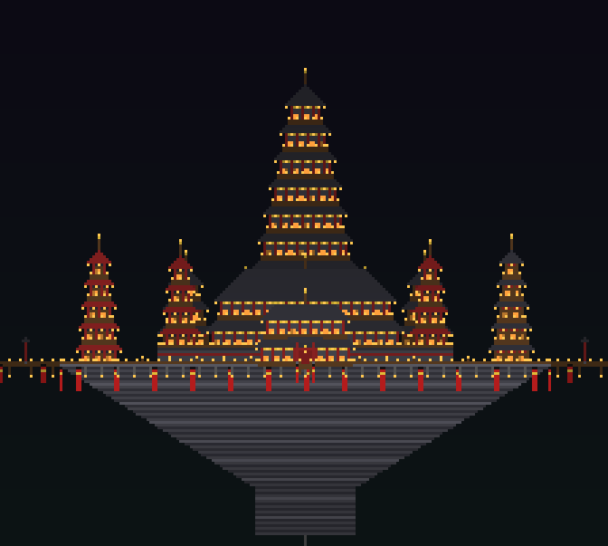
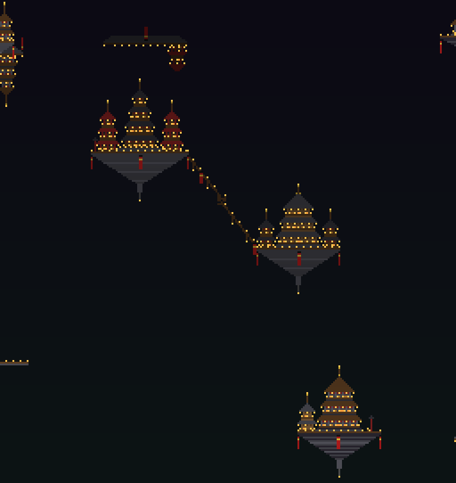

# Infinite Lantern Palace (Minecraft 26.3, Fabric)

A brand-new Fabric mod that adds a **peaceful** Infinity Castle dimension: a gigantic lantern-lit Japanese palace
(nine-tier central tower, great hall, side halls, corner pagodas, gate house, red stairway, torii procession) floating
in a dark void, surrounded by **hundreds of floating castles, pagodas, halls, shrines and citadels** — upright, inverted
and rotated — joined by an endless web of wooden bridges, covered lantern corridors, stair-stepped ramps, torii gates
and hanging red banners. Everything is real blocks, generated procedurally and deterministically from the world seed.




*(These previews are side-elevation renders of the actual generator output, produced by `tools/Validate.java`.)*

## Peaceful by design
* **No PvP, no fighting:** the server cancels any damage dealt by one living entity to another inside the dimension
  (player↔player, mob→player, player→animal). Environmental damage (falling, fire) still exists.
  Want players to be able to hit animals? set `PeacefulRules.PROTECT_ANIMALS_FROM_PLAYERS = false`.
* **No hostile mobs:** the biome has *no* monster spawns, and any hostile mob (`Enemy`) is removed the instant it loads
  in the dimension (spawn eggs, spawners, commands…). The ender dragon fight is disabled in the dimension type.
* **Friendly mobs only:** sheep, cows, pigs, chickens and rabbits spawn naturally on the grass lawns in the palace
  courtyard (lanterns keep them lit).
* Vanilla difficulty is per-world and cannot be per-dimension, so this is enforced by the mod, not by `/difficulty`.

## Using it
| Command | What it does |
|---|---|
| `/infinitycastle enter` | Teleports you to the palace courtyard (`0.5, 67, 69.5`), facing the palace. Your previous location is remembered. |
| `/infinitycastle exit`  | Returns you to where you came from (or overworld `0,0` if that is unknown, e.g. after a server restart). |

You get 8 seconds of slow falling on every teleport. If you ever fall below the world, you are lifted back to the courtyard.
Walk out of the great gate or along any of the four causeways to reach the first ring of castles; from there bridges
connect neighbouring castles at the same or adjacent height bands (8 bands, y = 28 … 436). Creative flight is the
easiest way to see it all.

Works on singleplayer, LAN and dedicated servers (all server-side; clients just need the mod installed too because of
the registered feature — Fabric API required).

## Build
Requirements: JDK 25, internet (Gradle downloads Minecraft/Fabric).
```
./gradlew build          # jar in build/libs/infinite-lantern-palace-1.0.0.jar
```
CI: `.github/workflows/build.yml` validates the generator, runs `./gradlew build`, and uploads the artifact
**`infinity-castle-jar`** (plus `generator-previews`). Push this folder to a new GitHub repository and the workflow runs automatically.

Verified versions (from FabricMC/fabric-example-mod branch `26.3` and the Fabric 26.3 announcement):
Minecraft 26.3 · Fabric Loader 0.19.5 · Fabric API 0.162.0+26.3 · Loom 1.18-SNAPSHOT (`net.fabricmc.fabric-loom`) ·
Gradle 9.7.1 (wrapper included) · Java 25 · official Mojang names (26.x is unobfuscated).

## How it works
```
src/main/java/com/lanternpalace/infinitycastle/
  InfinityCastleMod.java      entrypoint, registers the worldgen Feature
  CastleCommands.java         /infinitycastle enter|exit
  TravelManager.java          teleport in/out, return points, void safety net
  PeacefulRules.java          no PvP / no attacks / hostile-mob removal
  Dimensions.java             dimension key
  worldgen/CastleFeature.java Feature run once per chunk during decoration
  worldgen/BlockMapper.java   abstract material cells -> vanilla BlockStates
  gen/                        PURE JAVA generator (no Minecraft imports; unit-testable)
    WorldPlan  grid layout, castle/bridge lookup     Palace    the central palace
    Castles    5 castle families                     Bridge    bridges/corridors
    Build      storeys, hip roofs, pagodas, torii…   Canvas    per-chunk clipped raster + rotate/flip
src/main/resources/data/lantern_palace/
  dimension/infinity_castle.json            noise generator + fixed biome
  dimension_type/infinity_castle.json       y -64..511, no dragon fight, dark fog, end skybox
  worldgen/noise_settings/void.json         all-zero density = pure void
  worldgen/biome/lantern_void.json          friendly animals only; carries the castle feature
  worldgen/{configured,placed}_feature/castle.json
tools/Validate.java           generator test + preview renderer
```
**Seamless generation:** the terrain is empty void; the only thing that places blocks is `CastleFeature`, which for each
chunk rebuilds a 16×576×16 `Canvas`, re-draws every structure whose bounding box overlaps that chunk (structure
positions are pure functions of world seed + 96-block grid cell), and writes only that chunk's own column. No chunk ever
writes into another, so there are no seams, no chunk-load callbacks, no cross-chunk waits and no world scans.
Measured: ~3 ms per palace chunk, <20 ms worst case in the far field.

## Status / honesty
* **Verified:** generator compiles and passes `tools/Validate.java` (determinism, spawn floor + headroom, 592 castles
  within ±1000 blocks, lantern/window counts, performance). All JSON validated; data formats copied from the vanilla 26.3 data
  (mcmeta `26.3-data`) and Fabric's 26.3 test mods; Fabric API signatures checked against the 26.3 sources.
* **NOT yet verified:** the Minecraft-facing Java (`worldgen/`, `*Manager`, `*Commands`, `PeacefulRules`) has **not been compiled
  or run** — the build sandbox could not reach Fabric's Maven. First-run risks, in order: a renamed vanilla method in
  `BlockMapper`/`CastleFeature`, noise-settings or dimension-type JSON rejected by the 26.3 codecs, and in-game visual tuning.
  Run the GitHub workflow and report any compiler/loader error text — each is a small, local fix.
* Not implemented: a portal block (commands only), persistence of return points across server restarts.
